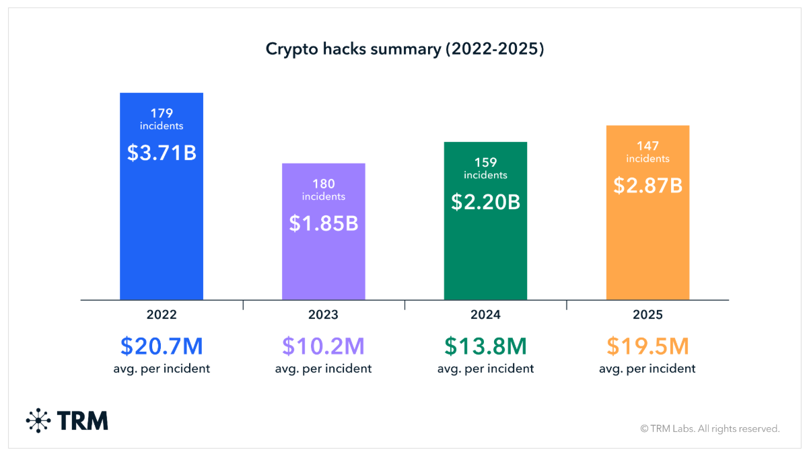
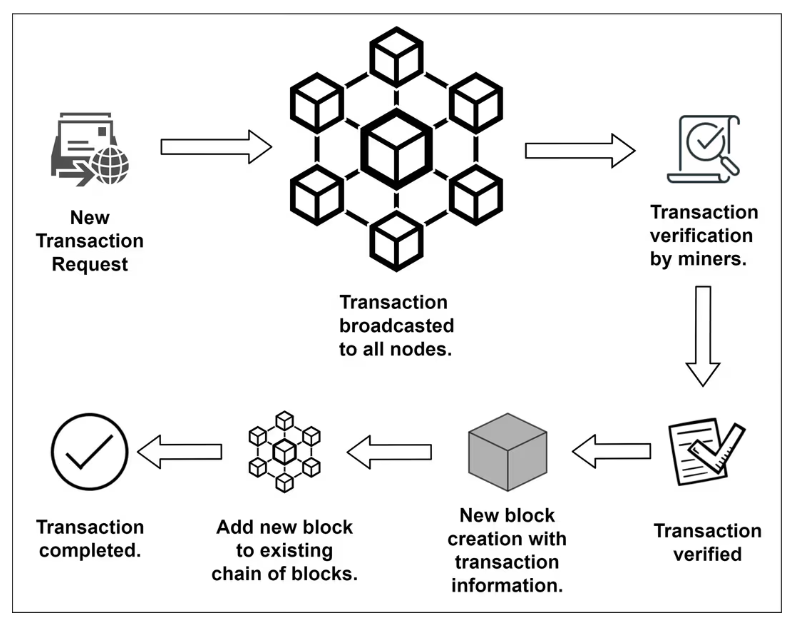
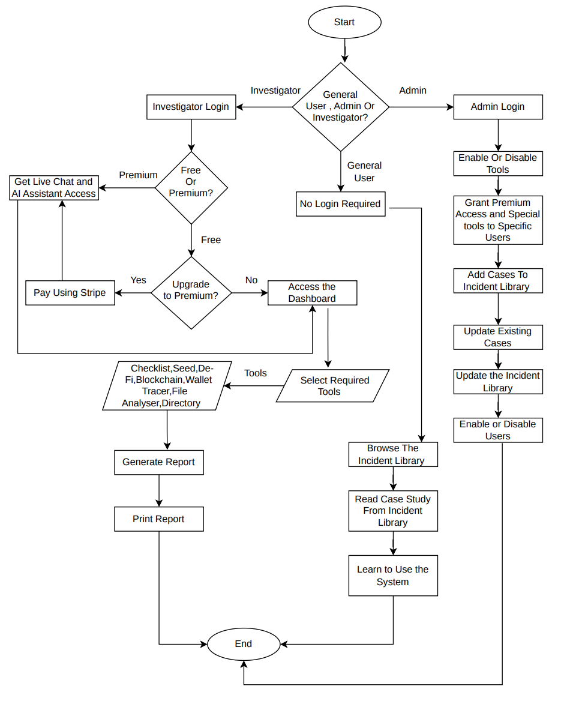
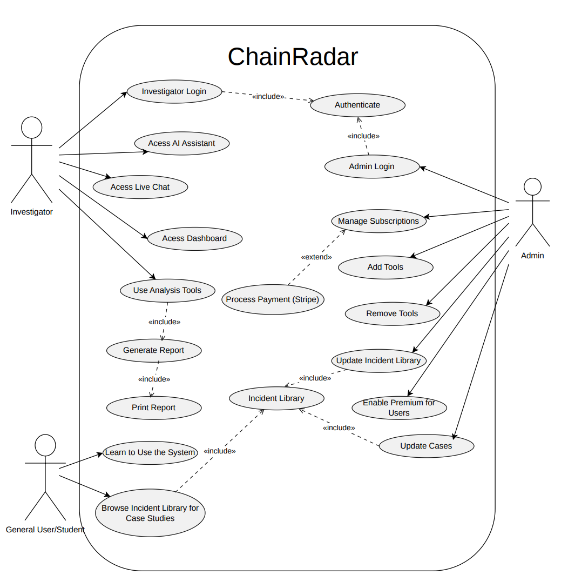
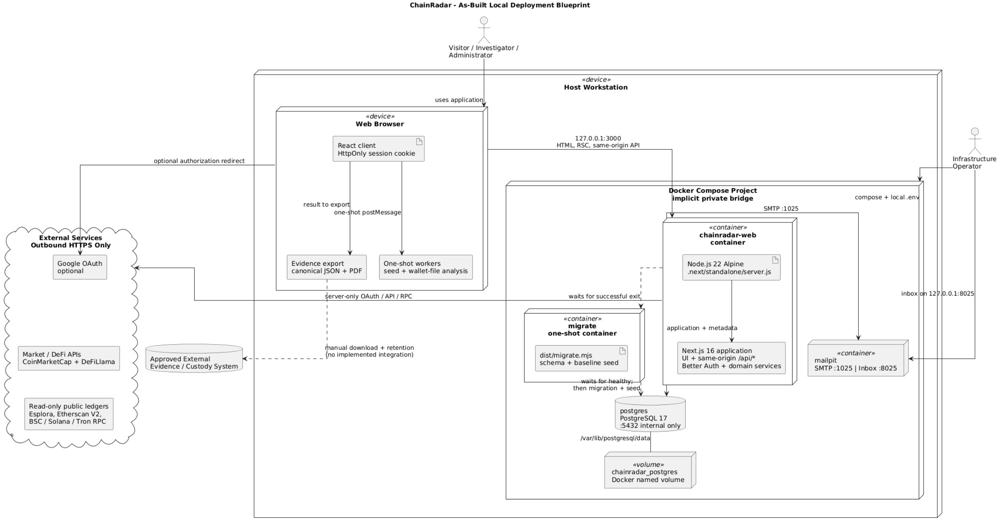
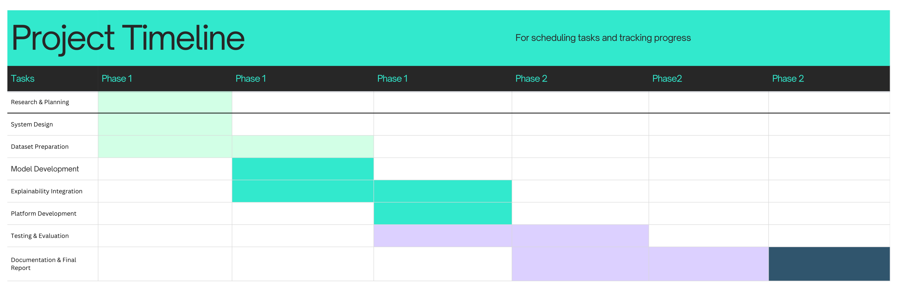

:::::: titlingpage
::::: normalsize
::: center
{width="1.5in" height="1in"}\
**TRIBHUVAN UNIVERSITY\
INSTITUTE OF ENGINEERING\
**SAGARMATHA ENGINEERING COLLEGE**\**
:::

::: center
**A**\
**PROJECT REPORT**\
**ON**\
\
**BY\
**Ashutosh Chandra Shah SEC079BCT010**\
**Kshitiz Raj Shrestha SEC079BCT017**\
**Shruti Kumari Jha SEC079BCT032**\
\
**\
SANEPA, LALITPUR, NEPAL\
2026-11-06****
:::
:::::
::::::

# ABSTRACT {#abstract .unnumbered}

The rapid expansion of blockchain ecosystems has triggered a significant
rise in sophisticated financial crimes and smart contract exploits.
While public ledger data is abundant, it is difficult to use
responsibly. Distinct data types---such as block explorer confirmations,
news reports, and commercial address labels---are routinely collapsed
into single unverified findings. To resolve this, this project
introduces ChainRadar, a governed web platform for authorized
cryptocurrency incident research. ChainRadar keeps deterministic ledger
observations, source-qualified claims, and investigator analysis
explicitly separate throughout its workflow. The platform integrates a
public incident library, versioned checklists, and bounded read-only
adapters across Bitcoin, EVM networks, Solana, TRON, and Monero.
Crucially, each adapter returns the acquisition time, provider, network,
and query limits alongside every observation to ensure rigorous data
provenance.

ChainRadar's analytical core replaces predictive black-box models with a
source-qualified Address Intelligence Directory and a bounded Wallet
Flow Tracer. Instead of inferring exhaustive fund-flow histories, this
tracer reconstructs reviewable transaction graphs within strict limits.
To mitigate attribution risks in regulatory contexts, the platform never
converts matching addresses into automated claims of identity or guilt.
Every reviewed association explicitly logs its publisher, source record,
and limitations, enabling independent reproduction rather than blind
trust. Furthermore, sensitive credentials like seed phrases are
processed strictly within isolated browser workers to guarantee
security. Investigations are exported via an evidence builder into
canonical JSON with detached SHA-256 manifests and human-readable PDFs.
ChainRadar provides a structured, source-qualified record that
investigators can examine and verify. This architecture minimizes
overstated attribution, ensures transparent evidentiary reasoning, and
establishes a defensible framework for cryptocurrency incident research
and digital evidence production.

**Keywords:** Blockchain Forensics, Source-Qualified Attribution,
Digital Evidence Provenance, Cryptocurrency Investigation Tooling,
Wallet Security

# LIST OF ABBREVIATIONS {#list-of-abbreviations .unnumbered}

AML Anti-Money Laundering\
API Application Programming Interface\
BIP Bitcoin Improvement Proposal\
BIP32 Hierarchical Deterministic Wallets\
BIP39 Mnemonic Code for Generating Deterministic Keys\
BIP44 Multi-Account Hierarchy for Deterministic Wallets\
BIP49 Derivation Scheme for P2WPKH-nested-in-P2SH Accounts\
BIP84 Derivation Scheme for P2WPKH Based Accounts\
BIP86 Key Derivation for Single Key P2TR Outputs\
CoC Chain of Custody\
CUDA Compute Unified Device Architecture\
DAO Decentralised Autonomous Organisation\
DeFi Decentralised Finance\
EVM Ethereum Virtual Machine\
HD Hierarchical Deterministic\
JSON JavaScript Object Notation\
LIME Local Interpretable Model-agnostic Explanations\
LLM Large Language Model\
MCC Matthews Correlation Coefficient\
P2P Peer-to-Peer\
P2SH Pay to Script Hash\
P2TR Pay to Taproot\
P2WPKH Pay to Witness Public Key Hash\
RPC Remote Procedure Call\
SHAP SHapley Additive exPlanations\
TVL Total Value Locked\

# INTRODUCTION

## Background

Blockchain networks form the foundation of decentralised finance (DeFi),
enabling trustless, permissionless exchange of digital assets across
smart contracts and peer-to-peer protocols [@NISTIR_8202; @NISTIR_8475].
Key principles such as immutability, transparency, and censorship
resistance are central to these systems. Both traditional financial
infrastructure and modern blockchain-based platforms are currently in
practice. Although they share the same ultimate goal of value transfer,
their operational methods differ significantly. Traditional financial
crime detection relies on centralised databases, rule-based transaction
monitoring, and manual investigation, supervised by compliance officers
with physical audit trails. Financial integrity is vital not only for
the legitimacy of decentralised ecosystems but also for maintaining
investor trust and regulatory
confidence [@Weber2019; @Elmougy2023; @Cheng2024].

Several terms recur throughout this discussion and are defined here for
clarity. Crypto-incident investigation refers to the structured process
of examining a reported hack, scam, exploit, or suspicious pattern of
activity on a public ledger, with the goal of establishing what
happened, which addresses and transactions were involved, and what
evidence supports that account. It differs from generic blockchain
analytics in that its output is expected to withstand independent
scrutiny, not merely to satisfy a single analyst's curiosity. Blockchain
evidence is any ledger-derived or source-derived material used to
support a finding in such an investigation, such as a transaction hash,
an address balance, a dated attribution claim, or a wallet artefact,
and, as established below, exists in both a live and a fixed evidentiary
form. Post-hack research denotes the retrospective study of a confirmed
incident after the fact by reconstructing an attack's timeline, tracing
where stolen funds moved, and documenting the pattern for future
reference, as distinct from monitoring that attempts to catch an attack
while it is still unfolding. Total value locked (TVL) is a
provider-calculated estimate of the total value of digital assets
deposited in a DeFi protocol's smart contracts at a given moment,
commonly used as a proxy for a protocol's size and economic
significance, though not itself proof of how that value is currently
being used [@Saggese2025TVL]. Finally, provider APIs are the
programmatic interfaces operated by block explorers, node operators, and
market-data services through which an investigation platform queries
ledger state, transaction history, or DeFi metrics rather than running
its own full blockchain node. Because different providers expose
different data models, coverage, and freshness guarantees, the provider
behind a given observation is itself part of that observation's
evidentiary
context [@EthereumJSONRPC; @BitcoinDevReference; @EtherscanAPIv2].

A public ledger record can be examined in two distinct evidentiary
states. Hot evidence is a live, provider-mediated observation, such as
an address balance, a pending transaction, or a TVL figure queried
directly from a node or data provider at the moment of investigation.
Hot evidence is current but mutable, as a re-query minutes later can
return a different value when chains reorganise, providers update their
indexes, or mempool state
changes [@EthereumJSONRPC; @BitcoinDevReference; @LiuJiang2020Survey].
Cold evidence, by contrast, is a fixed, acquisition-timestamped snapshot
of that same observation, bound to a canonical machine-readable record
and a detached cryptographic digest so that its exact byte content can
be independently reverified at any later
date [@GreyHashCoC2022; @FIPS_180_4; @RFC8785]. Existing blockchain
analytics tools overwhelmingly operate only in the hot-evidence regime:
a dashboard or explorer answers a query and discards the acquisition
context the moment the page is closed, leaving an investigator with no
reproducible artefact to defend in a later review. ChainRadar treats
this gap as a first-class design problem, converting every hot
observation an investigator relies on into a cold, hashed, independently
reproducible record before it is used to support a finding.

Address-level investigation compounds this problem because a raw
transaction graph does not by itself reveal who controls a given
address. Prior work has shown that addresses can be clustered and
labelled using behavioural heuristics and provider-maintained
attribution databases [@Wang2020], and that wallet artefacts recovered
from client devices, including keys, transaction identifiers, and
timestamps, can themselves serve as forensic evidence when properly
extracted [@Chang2022WalletForensics; @NIST_SP_800_86]. These findings
motivate a source-qualified approach. Rather than inferring identity or
intent directly from graph structure, ChainRadar records only what a
reviewed, dated, and sourced claim actually asserts about a
network-specific address, keeping that claim visibly separate from the
raw ledger observation it is attached to and from any analyst's own
reasoning about it.

Beyond address attribution, DeFi-specific metrics introduce their own
verifiability gap. Total value locked (TVL), the standard measure of a
protocol's economic footprint, is frequently computed through
inconsistent, partly off-chain methodologies across data aggregators,
making published figures difficult to independently
reproduce [@Saggese2025TVL]. Rather than presenting such figures as
settled fact, ChainRadar surfaces TVL and related DeFi metrics as
provider-attributed context, complete with acquisition time and dataset
version, so that a reader can judge how much weight the figure can bear.
Underpinning the platform's handling of sensitive material, including
seed phrases and derived keys, is the BIP-39 mnemonic standard, which
defines how a word-based backup deterministically recreates a wallet's
key tree [@BIP39; @BIP32; @BIP44].

The practical significance of this standard lies in how far a single
seed extends. BIP-39 does not by itself produce keys; it converts a
mnemonic phrase into a 512-bit seed, which is then fed into a
hierarchical deterministic (HD) wallet scheme, most commonly the BIP-32
derivation tree extended by BIP-44's multi-account, multi-network path
structure. From this single seed, a wallet can deterministically derive
an effectively unlimited number of private keys and public addresses,
organised along a structured path with a different network, a different
account within that network, or simply the next address in sequence.
Every address generated this way is mathematically reproducible from the
seed alone. No record of individual addresses needs to be kept because
any one of them can be regenerated on demand by walking the same
derivation path again. This is precisely what makes a seed phrase so
consequential from a security standpoint. Possessing it is equivalent to
possessing every wallet, on every supported network, that has ever been
or could ever be derived from it, not merely the handful of addresses an
investigator happens to have observed on-chain. ChainRadar's own
seed-handling tools reflect this scope directly. Rather than deriving
one address at a time, the platform can walk this same tree to preview a
bounded set of candidate addresses locally, entirely within an isolated
browser process, so that the seed itself never leaves the investigator's
device and never enters the hot-evidence pipeline at all. Continued
growth in cryptocurrency-related financial crime [@TRMLabs2026]
underscores the practical need for this discipline. As reported losses
and incident counts rise, the defensibility of an investigation
increasingly depends not on how quickly a claim can be generated, but on
how reliably it can be
reproduced [@Cheng2024; @NIST_SP_800_86; @ISOIEC_27037_2012].

## Problem Definition

Blockchain-based value exchanges are central to the stability of the
Web3 ecosystem, yet existing monitoring and forensic tools face
significant limitations. Many analytics platforms present a single
balance, transaction observation, or attribution label as a live,
self-contained fact, without recording the provider, acquisition time,
or dataset version behind it. Once the page is closed, that observation
cannot be independently reproduced or defended in a later review, even
though the underlying claim may have shaped an investigative
conclusion [@Weber2019; @Elmougy2023].

Current tooling is also fragmented, with separate, disconnected services
for address attribution, wallet-artefact analysis, DeFi metric tracking,
and transaction tracing, none of which agree on how a finding should be
recorded or cited [@LiuJiang2020Survey; @Wang2020]. During an active
incident, stolen assets can move rapidly through multiple wallets,
mixers, and cross-chain bridges, and an investigator working across
several disconnected tools has no consistent way to preserve exactly
what was observed, when it was observed, and from which
source [@Chang2022WalletForensics]. Key outstanding challenges include
reproducible evidence acquisition, transparent source-qualified
attribution, and defensible reporting that a second reviewer can
independently verify [@GreyHashCoC2022].

The urgency of these challenges is reflected in the \$2.87 billion lost
across 147 cryptocurrency-related incidents in 2025, with average losses
reaching \$19.5 million per attack [@TRMLabs2026]. Beyond direct theft,
DeFi-specific metrics compound the difficulty of establishing a
defensible record: total value locked (TVL), the standard measure of a
protocol's economic footprint, is frequently computed through
inconsistent, partly off-chain methodologies across data aggregators,
making published figures difficult to independently
reproduce [@Saggese2025TVL]. Smart-contract exploits and DeFi-protocol
attacks further widen this gap, as existing vulnerability-detection
tools largely operate in isolation from the evidence-reporting workflow
an investigator ultimately depends on [@Tang2023; @DeFiReview2023].

Despite blockchain's transparency and immutability, gaps remain in how
public ledger data is transformed into evidence: a raw block explorer
query is hot -- current, provider-mediated, and mutable -- while a
defensible finding requires cold evidence -- a fixed, timestamped,
hash-verifiable record that can be reproduced independently of the tool
that generated it. No existing platform treats this hot-to-cold
conversion as a first-class part of the investigation workflow, leaving
a critical gap between quick lookups and reviewable, reproducible
cryptocurrency incident reporting.

<figure data-latex-placement="ht">

 

<figcaption>Blockchain Transaction and Block Confirmation
Lifecycle</figcaption>
</figure>

As illustrated in the figure above, the financial scale of
cryptocurrency exploits remains massive and highly unpredictable,
presenting a persistent threat to the Web3 ecosystem [@TRMLabs2026].
Despite fluctuations in total losses over the years, 2025 witnessed a
sharp resurgence in attacker activity, with total stolen volume climbing
to \$2.87 billion across 147 recorded incidents. More alarmingly, the
average loss per incident surged to \$19.5 million in 2025, nearly
doubling the previous year's average, indicating that modern exploits
are becoming increasingly devastating and targeted. This rising
financial impact exposes a critical gap in current blockchain security
tooling: existing platforms operate as isolated lookups, providing a
momentary answer without a reproducible acquisition record, and offer no
structured way to separate a raw ledger fact from a sourced claim or an
investigator's own analysis. ChainRadar is designed to close this gap
directly by converting hot, provider-mediated observations into cold,
hash-verifiable evidence records, and by keeping ledger facts, source
claims, and analyst conclusions explicitly separate throughout the
investigation workflow [@Cheng2024; @GreyHashCoC2022].

## Objectives

The objectives of this project are:

- To design and implement a governed cryptocurrency investigation
  platform that facilitates transparent incident research and produces
  independently reproducible, hash-verifiable digital evidence.

- To securely acquire ledger observations via bounded adapters,
  integrate source-qualified wallet tracing into an interactive
  dashboard, and export the findings as reproducible cryptographic
  evidence
  reports [@LiuJiang2020Survey; @GreyHashCoC2022; @Wang2020; @Elmougy2023; @BIP39].

## Features

The features of our project are as follows:

- Bounded Multi-Chain Observation: Queries public ledger data across
  Bitcoin, EVM-compatible networks, Solana, TRON, and Monero through
  fixed, read-only adapters, returning each observation with its
  provider, network, acquisition time, and query limits rather than an
  unqualified figure [@LiuJiang2020Survey].

- Source-Qualified Address Intelligence: Matches a network-specific
  address against reviewed, dated source claims -- entity labels,
  sanction records, or incident associations -- and records the
  publisher, publication date, and relationship type alongside each
  match, keeping sourced claims explicitly separate from raw ledger
  facts [@Wang2020].

- Bounded Wallet Flow Tracer: Reconstructs a small, reviewable
  transaction graph from a single seed transaction within explicit
  depth, node, edge, and time limits, recording why expansion stopped
  rather than presenting an unbounded graph as a complete fund-flow
  history.

- Interactive Investigation Dashboard: Delivers a web-based interface
  built with React for browsing incidents, running governed lookups, and
  visualising bounded transaction graphs with full provenance for each
  displayed node and edge.

- Cold Evidence Reporting: Converts every hot, provider-mediated
  observation an investigator relies on into a canonical JSON record
  with a detached SHA-256 manifest and a human-readable PDF, producing a
  reproducible evidence package that a second reviewer can independently
  verify [@GreyHashCoC2022].

- Local Seed and Wallet Forensics: Performs BIP39 mnemonic generation,
  address derivation, and wallet-file classification entirely within an
  isolated browser worker, ensuring seed phrases, private keys, and
  wallet credentials never leave the local
  device [@BIP39; @Chang2022WalletForensics].

## System Requirements

The system requirements of our project are:

### Software Requirements

The software requirements for our project are as follows:

- Node.js 20+ (Next.js 15 runtime)

- React (web interface)

- TypeScript

- PostgreSQL 17

- Browser Web Workers (local, isolated secret handling)

- Docker and Docker Compose

- Public-ledger read-only providers (Bitcoin, EVM-compatible networks,
  Solana, TRON, Monero)

- DeFi/market data providers (e.g. CoinGecko, DeFiLlama-class APIs)

- Managed TLS / reverse proxy for HTTPS termination

- SMTP service (transactional email)

### Hardware Requirements

The hardware requirements for our project are as follows:

- A standard workstation or server; no GPU is required, since the
  platform performs governed API orchestration and local browser-side
  computation rather than model training or inference.

- Minimum 4 GB RAM for the web runtime and PostgreSQL instance under
  typical investigation workloads.

- Minimum 10 GB SSD storage for the PostgreSQL volume, published
  incident content, and cached evidence-report artefacts.

- Standard internet connection with stable access to configured
  public-ledger and market-data providers.

### Functional Requirements

The functional requirements of the system are:

- Bounded, read-only acquisition of public ledger data across supported
  networks through fixed provider adapters, with acquisition time,
  provider identity, and query limits recorded for every observation.

- Reconstruction of a depth-limited transaction graph from a single seed
  transaction, with explicit node, edge, and time bounds and a recorded
  reason for expansion stopping.

- Source-qualified matching of network-specific addresses against
  reviewed, dated claims, keeping ledger observations, source claims,
  and investigator analysis in clearly separated records.

- Local, browser-isolated generation, derivation, and classification of
  seed phrases, private keys, and wallet-file artefacts, with no
  transmission of secret material to any server route.

- Conversion of confirmed observations into canonical JSON with stable
  field ordering, detached SHA-256 manifests, and a human-readable PDF,
  supporting draft and reviewed-final report states.

- Interactive web dashboard allowing investigators to query wallet
  addresses, transaction hashes, or DeFi protocols and review the
  resulting bounded evidence graph and report history.

- Versioned investigation checklists and a public incident library that
  let investigators and readers understand attack patterns before
  starting independent research.

### Non-functional Requirements

The non-functional requirements of our system are as follows:

- Performance: The system should return governed lookups and render
  bounded transaction graphs within a latency acceptable for interactive
  investigation, without relying on continuous background ingestion.

- Reliability: Provider adapters must fail closed on schema, integrity,
  or chain-identity errors rather than returning a fabricated or
  silently incomplete result, and may rotate among independently
  authorized provider credentials only after retryable availability or
  rate failures.

- Evidentiary Integrity: Every exported report must be bound to a
  canonical JSON representation and a detached SHA-256 manifest, so that
  any later change to the underlying bytes is independently detectable.

- Security: Sensitive inputs -- seed phrases, private keys, and wallet
  files -- must never cross the browser-local secret boundary into a
  server request, and all server routes must enforce session, role, and
  per-tool authorization checks.

- Portability: The system must be fully containerised with Docker
  Compose, deployable on any standard workstation or server with network
  access to configured providers, without dependence on specialised
  hardware.

- Availability: The platform must provide a stable, monitored public
  service with health checks and error monitoring, ensuring that
  provider or component failures degrade gracefully into a labelled
  unavailable state rather than an unhandled failure.

# LITERATURE REVIEW

Blockchain technology has introduced a transparent and immutable
transaction ledger, but its pseudonymous and permissionless nature has
also enabled financial crimes such as money laundering, ransomware
payments, phishing, fraud, and illicit fund
transfers [@NISTIR_8202; @NISTIR_8475; @Weber2019]. Consequently,
blockchain forensics has become an active research area focused on
identifying suspicious transactions, tracing cryptocurrency movement,
and supporting digital investigations. Weber et al. demonstrated that
representing blockchain transactions as graphs enables Graph
Convolutional Networks (GCNs) to outperform traditional machine learning
techniques for anti-money laundering by exploiting the relationships
between connected transactions rather than analysing them
independently [@Weber2019]. Expanding upon this work, Elmougy and Liu
introduced a significantly larger benchmark containing labelled wallet
addresses and multiple graph representations, improving research on both
transaction-level and address-level financial forensics [@Elmougy2023].
Cheng et al. surveyed Graph Neural Network (GNN) approaches for
financial fraud detection and identified scalability, explainability,
class imbalance, and adversarial behaviour as major research challenges
that remain unresolved [@Cheng2024]. These unresolved challenges are
particularly consequential in investigative and regulatory contexts,
where a probabilistic anomaly score that cannot be independently
reproduced or defended carries meaningful attribution risk; this
observation motivates an evidence-governance approach to blockchain
investigation rather than a purely predictive one, which is the
direction this project adopts.

While fraud detection identifies suspicious behaviour, blockchain
investigations also require identifying the entities behind
cryptocurrency addresses and reconstructing transaction histories. Wang
et al. presented techniques for cryptocurrency address clustering and
labelling, demonstrating how multiple blockchain addresses can often be
attributed to a single user or organisation using transaction heuristics
and behavioural analysis [@Wang2020]. Liu et al. provided a
comprehensive survey of cryptocurrency transaction analytics, covering
transaction tracing, address attribution, anomaly detection,
privacy-preserving mechanisms, and forensic investigation techniques
across multiple blockchain platforms [@LiuJiang2020Survey]. Chang et
al. further extended blockchain investigations by analysing forensic
artefacts stored within Android cryptocurrency wallet applications,
showing that wallet metadata, keys, and locally stored information can
provide valuable evidence during digital forensic investigations,
provided that such sensitive material is extracted and handled without
ever leaving investigator-controlled
storage [@Chang2022WalletForensics; @NIST_SP_800_86]. This last point
directly informs the design of wallet- and seed-handling tools that
process credential material entirely on the client side rather than
transmitting it to a remote server.

Decentralized Finance (DeFi) introduces additional security challenges
because financial services are executed through smart contracts that
manage large amounts of digital assets. Tang et al. proposed deep
learning techniques for automated smart contract vulnerability
detection, reducing the likelihood of exploits caused by programming
errors [@Tang2023]. An empirical review of DeFi security highlighted
that existing vulnerability detection tools often struggle with complex
interactions involving multiple contracts, flash loans, and protocol
composability, indicating the need for more comprehensive security
analysis [@DeFiReview2023]. Saggese et al. further addressed
transparency within decentralized finance by showing that Total Value
Locked (TVL) is frequently computed through inconsistent, partly
off-chain methodologies across data aggregators, making published
figures difficult to independently verify, and proposed mechanisms for
improving confidence in financial metrics reported by DeFi
protocols [@Saggese2025TVL]. This finding underscores the value of
presenting DeFi metrics as provider-attributed, dated context rather
than settled fact.

Reliable blockchain investigations require not only accurate analysis
but also trustworthy evidence management. Maintaining the integrity and
provenance of digital evidence is essential when investigation reports
are intended for legal, regulatory, or organisational use.
Grey-hash-based chain-of-custody mechanisms combined with blockchain
technology have been proposed to preserve evidence authenticity and
ensure that forensic artefacts remain verifiable throughout the
investigation lifecycle [@GreyHashCoC2022]. This approach emphasises
three properties that recur across the digital forensics literature more
broadly: evidence integrity, meaning that any later modification to an
artefact's bytes must be independently detectable; reproducibility,
meaning that a second reviewer can reacquire or reverify the same
finding; and auditability, meaning that the acquisition method, source,
and timestamp of a claim remain attached to it throughout its
lifecycle [@ISOIEC_27037_2012; @SWGDE_18_F_002; @SWGDE_18_Q_002]. These
same three properties directly inform the canonical-record and
detached-manifest approach used for evidence export in this project,
while standard hashing and canonicalisation practices help make exported
records independently verifiable [@FIPS_180_4; @RFC8785].

Secure wallet management also plays an important role in blockchain
ecosystems. The BIP39 standard defines a deterministic mnemonic phrase
generation mechanism that enables users to securely back up and recover
cryptocurrency wallets using human-readable seed phrases, and specifies
how such a phrase deterministically derives an entire tree of keys and
addresses [@BIP39; @BIP32; @BIP44]. Because a seed phrase or private key
is effectively a live, transaction-authorising credential, prior
wallet-forensics work reinforces that such material should be generated,
derived, and inspected in an isolated, non-persistent context rather
than processed through a networked service [@Chang2022WalletForensics].
Although BIP39 is primarily designed for wallet recovery rather than
forensic analysis, the standard forms an essential component of
cryptocurrency infrastructure and directly grounds the local,
browser-isolated seed- and wallet-handling design adopted in this
project.

Industry reports continue to demonstrate the growing importance of
blockchain forensic platforms. According to the 2026 Crypto Crime Report
published by TRM Labs, cryptocurrency-related crimes continue to evolve
alongside increasing blockchain adoption, creating greater demand for
investigation platforms capable of consolidating evidence, tracing
transactions, documenting findings, and supporting regulatory
compliance [@TRMLabs2026]. Understanding the blockchain transaction
lifecycle is equally important for interpreting transaction propagation,
validation, and confirmation during forensic investigations [@sita]. In
practice, this also means that investigators must be able to distinguish
between live provider responses and fixed evidentiary records, because
the same query may return different values depending on node state,
indexing freshness, or chain conditions at the time of
acquisition [@EthereumJSONRPC; @BitcoinDevReference; @EtherscanAPIv2].

Existing research provides strong foundations for fraud detection,
address attribution, transaction tracing, smart contract security, and
evidence preservation. However, most solutions focus on individual
aspects of blockchain investigation rather than providing an integrated
platform that combines transaction research, evidence collection, source
qualification, governance, and structured reporting; and few, if any,
explicitly separate a live, provider-mediated observation from a fixed,
independently verifiable evidentiary record. This gap motivates the
development of ChainRadar, a governed platform designed to support
cryptocurrency incident research by converting hot, provider-mediated
observations into cold, hash-verifiable evidence through structured
evidence collection, source-qualified documentation, and comprehensive
investigation reporting.

# RELATED THEORY

## Blockchain

Blockchain technology is a decentralised, distributed ledger that
maintains a secure record of digital transactions. When a user
broadcasts a transaction to the peer-to-peer network, participating
nodes validate it via consensus mechanisms. Validated transactions are
aggregated into blocks, which are then linked chronologically using
cryptographic hash functions. This tamper-evident structure ensures
immutability; because every node holds an identical copy of the ledger,
retroactive falsification is computationally near-infeasible without
subverting a majority of the network's computational
power [@Weber2019; @NISTIR_8202].

<figure data-latex-placement="ht">

 

<figcaption>Blockchain Transaction and Block Confirmation
Lifecycle</figcaption>
</figure>

### Smart Contracts

Smart contracts are self-executing programs deployed on blockchains that
automatically enforce predefined rules. In decentralised finance (DeFi),
they manage high-value assets across lending protocols and liquidity
pools. Consequently, logic vulnerabilities like reentrancy or integer
overflows can lead to catastrophic losses, as seen in historical
exploits like the DAO attack or the bZx oracle
manipulation [@DeFiReview2023; @Tang2023].

### Ethereum and the EVM

Ethereum is the primary platform for smart contracts, which are written
in Solidity and executed within the Ethereum Virtual Machine (EVM). The
EVM processes state changes deterministically and records them
immutably. Its extensive documentation and dominant share of total value
locked make it one of the most consequential networks for public
blockchain investigation and address-level
analysis [@DeFiReview2023; @LiuJiang2020Survey; @EtherscanAPIv2].

### Decentralised Finance (DeFi)

DeFi encompasses financial services implemented entirely through
permissionless smart contracts. Controlling immense monetary value,
composable DeFi protocols are high-stakes targets for malicious
exploits. While existing analytical tools handle single-contract
scenarios, they frequently fail against complex, cross-protocol exploits
and flash-loan dynamics [@DeFiReview2023]. Furthermore, headline metrics
such as Total Value Locked (TVL) are themselves often computed through
inconsistent, partly off-chain methodologies, making them difficult to
independently verify without additional context [@Saggese2025TVL].

### Hot Evidence

A blockchain query can return a live, provider-mediated result at the
moment of query, such as an address balance. A hot observation is a
live, provider-mediated response returned at the moment of query -- an
address balance, a pending transaction's status, or a protocol's current
TVL. Hot observations are current but inherently mutable: a chain
reorganisation, a provider index update, or simple mempool churn can
cause an identical query to return a different result minutes This kind
of result is current but inherently mutable: a chain reorganisation, a
provider index update, or simple mempool churn can cause an identical
query to return a different result minutes
later [@LiuJiang2020Survey; @EthereumJSONRPC; @BitcoinDevReference].
This mutability is a natural consequence of blockchain state being
continuously updated, and it is not a flaw in any individual provider.

### Cold Evidence

A cold record is a fixed, acquisition-timestamped snapshot of a hot
observation, bound to a canonical machine-readable representation and a
detached cryptographic digest, so that its exact byte content can be
independently reverified at any later date. This mirrors established
chain-of-custody principles in digital forensics, where evidence
integrity depends on a verifiable record of what was observed, when, and
under what method, rather than on the observation itself remaining true
indefinitely [@GreyHashCoC2022; @FIPS_180_4; @RFC8785]. In practice,
most public blockchain tooling operates only in the hot regime,
answering a query and discarding its acquisition context once the
interface is closed. Converting a hot observation into a cold,
hash-verifiable record before it is used to support a finding is treated
as a first-class requirement throughout the remainder of this project,
rather than an optional export feature.

### Chain Radar and Evidence Workflow

The combination of wallet determinism, provider-mediated observations,
and mutable blockchain state creates a clear need for disciplined
evidence handling. A browser-visible balance, transaction status, or TVL
reading is useful for live investigation, but it is not by itself a
stable forensic record. For that reason, this project distinguishes
between a live query and a preserved evidentiary artefact, and it treats
the conversion from one to the other as part of the investigation
process rather than an afterthought. This design is consistent with the
broader forensic principles of integrity, repeatability, and
provenance [@ISOIEC_27037_2012; @SWGDE_18_F_002; @SWGDE_18_Q_002].

## Bitcoin Improvement Proposals (BIPs) for Wallet Derivation

Bitcoin Improvement Proposals (BIPs) define widely adopted standards for
wallet recovery, hierarchical deterministic key derivation, and address
formatting in cryptocurrency systems. In this project, the BIP family is
important because it explains how a single recovery phrase can
deterministically generate many wallet keys and addresses, and why that
material must be treated as highly sensitive during investigation and
evidence handling [@BIP39; @BIP32; @BIP44; @BIP49; @BIP84; @BIP86].

### BIP39: Mnemonic Code for Generating Deterministic Keys

BIP39 defines the mnemonic seed phrase format used to back up and
recover cryptocurrency wallets. It converts cryptographic entropy into a
human-readable sequence of words, together with a checksum, so that the
same wallet seed can be recreated later. Standard BIP39 mnemonic lengths
are 12, 15, 18, 21, or 24 words, increasing in steps of three words
rather than arbitrary lengths. The mnemonic is then processed into a
512-bit seed, which serves as the root input for hierarchical
deterministic wallet derivation [@BIP39].

### BIP32: Hierarchical Deterministic Wallets

BIP32 defines hierarchical deterministic (HD) wallets, where one master
seed can generate an entire tree of private keys and public addresses.
Instead of storing each address separately, the wallet derives child
keys along a structured path from the master key. This makes wallet
backup and recovery more scalable, since the same seed can regenerate
the full key hierarchy whenever needed [@BIP32].

### BIP44: Multi-Account Hierarchy for Deterministic Wallets

BIP44 extends the BIP32 model by introducing a standard multi-account
derivation structure. This structure allows wallets to separate
different cryptocurrencies, accounts, and address chains while still
deriving them from a single seed. BIP44 makes wallet organisation more
consistent across applications and networks [@BIP44].

### BIP49: Nested SegWit Derivation

BIP49 defines a derivation scheme for nested SegWit accounts,
specifically P2WPKH-in-P2SH addresses. This standard was introduced to
support SegWit-compatible wallets before native SegWit became
widespread. It preserves compatibility with older infrastructure while
still benefiting from SegWit-style transaction improvements [@BIP49].

### BIP84: Native SegWit Derivation

BIP84 defines a derivation scheme for native SegWit accounts using
P2WPKH addresses. Compared with nested SegWit, native SegWit reduces
transaction size and improves efficiency by using a cleaner address
format. It is now a common standard for modern Bitcoin wallets that
support SegWit natively [@BIP84].

### BIP86: Taproot Single-Key Derivation

BIP86 defines a derivation scheme for single-key Taproot outputs using
P2TR addresses. Taproot improves privacy, flexibility, and script
efficiency by allowing a single-key output structure that can be used
for modern wallet implementations. BIP86 builds on the same
deterministic wallet foundation as earlier BIPs, while aligning with
newer Bitcoin address and script standards [@BIP86].

### Relevance to Blockchain Investigation

These standards are relevant to blockchain investigation because they
show that a seed phrase is not just a backup string, but the root of a
deterministic wallet structure that can reproduce many addresses and
transactions across different derivation paths. For forensic work, this
means seed-related material must be handled carefully, because it can
expose the entire wallet history and all derived addresses associated
with it [@BIP39; @BIP32; @BIP44; @BIP49; @BIP84; @BIP86].

### Wallet Standards and Seed Phrases

Wallet recovery in modern cryptocurrency systems is commonly based on a
mnemonic seed phrase. A seed phrase is a human-readable sequence of
words that encodes wallet entropy and allows the same deterministic
wallet to be recreated later. In BIP39, the mnemonic is generated from
entropy plus a checksum, and the standard mnemonic lengths are 12, 15,
18, 21, or 24 words; these lengths increase in steps of three words
rather than using arbitrary word counts. The mnemonic is then converted
into a 512-bit seed using a key-derivation function, and that seed is
used as the root input for hierarchical deterministic wallet
derivation [@BIP39; @BIP32].

BIP32 defines the hierarchical deterministic (HD) wallet structure that
derives child keys from a single master seed. This means that one seed
can generate a tree of private keys and public addresses in a
reproducible way, without storing each key independently.

Additional derivation standards define common address types. BIP49
specifies derivation for nested SegWit accounts, using P2WPKH-in-P2SH
paths. BIP84 specifies native SegWit accounts using P2WPKH. BIP86
defines derivation for single-key Taproot outputs using P2TR. These
standards do not replace BIP32 or BIP39; rather, they sit on top of the
same deterministic root structure and define how different address
families are organised within it [@BIP49; @BIP84; @BIP86]. Because the
same seed can deterministically regenerate all derived keys and
addresses, seed-phrase handling must be treated as highly sensitive
material. For that reason, this project handles seed-related operations
locally and in an isolated context, rather than transmitting mnemonic
material to a remote service.

### BIP Summary

::: {#tab:bip_summary}
  **BIP**   **Full Name**                                          **Summary**
  --------- ------------------------------------------------------ --------------------------------------------------------------------------------------------------------------------
  BIP39     Mnemonic Code for Generating Deterministic Keys        Defines human-readable seed phrases and converts entropy into a mnemonic that can be used to reconstruct a wallet.
  BIP32     Hierarchical Deterministic Wallets                     Defines a tree-based wallet structure where one master seed can generate many child keys and addresses.
  BIP44     Multi-Account Hierarchy for Deterministic Wallets      Extends HD wallets with a standard path for organising multiple accounts, coins, and address chains.
  BIP49     Derivation Scheme for P2WPKH-nested-in-P2SH Accounts   Defines nested SegWit derivation for compatibility with older wallet infrastructure.
  BIP84     Derivation Scheme for P2WPKH Based Accounts            Defines native SegWit derivation using P2WPKH addresses for more efficient transactions.
  BIP86     Key Derivation for Single Key P2TR Outputs             Defines Taproot-based single-key derivation using P2TR addresses for modern Bitcoin wallets.

  : Summary of BIPs Relevant to Wallet Derivation
:::

## Source-Qualified Address Attribution

A raw transaction graph reveals structural relationships between
addresses, but it does not by itself reveal who controls a given
address, or whether an address has been associated with a known entity,
exchange, or incident. Prior work has shown that addresses can often be
attributed to a common owner using clustering heuristics applied to
transaction behaviour, and that such attributions are typically
maintained as provider- or community-curated label databases rather than
derived fresh for every query [@Wang2020]. Liu et al. similarly identify
traceability and linkability analysis -- determining whether transfers
can be chained together and whether addresses can be linked to the same
identity -- as a foundational line of blockchain analytics research,
distinct from, and prerequisite to, any downstream anomaly or risk
assessment [@LiuJiang2020Survey].

Rather than inferring identity directly from graph structure, this
project formalises attribution as an explicit, reviewed claim record
rather than a model-derived score. An address-intelligence record can be
defined as a tuple:

$$\begin{equation}
    C = (n, a, e, r, p, d, s, \ell)
\end{equation}$$

where $n$ is the network on which the claim applies, $a$ is the exact
address string on that network, $e$ is the named entity or category
asserted by the source (e.g. exchange, custodian, sanctioned entity,
threat-actor group), $r$ is the relationship type expressed with
explicit epistemic qualification (e.g. *source-attributed*, *alleged*),
$p$ is the publisher, $d$ is the publication date, $s$ is a reference to
the original source record, and $\ell$ is a statement of the claim's
known limitations. A claim $C$ is only ever attached to an address as a
labelled, dated assertion; it is never merged with, or presented as
equivalent to, a deterministic ledger observation. This separation
directly addresses a gap identified in prior wallet-forensics work,
where locally recovered wallet artefacts -- keys, transaction
identifiers, timestamps -- are treated as evidentiary material only when
their provenance and handling remain traceable throughout the
investigation [@Chang2022WalletForensics].

### Wallet Forensics and Seed Derivation

Understanding how a wallet's public identifiers are derived is necessary
for reasoning about both attribution and secure handling of credential
material. The BIP39 standard defines a deterministic process for
converting a source of entropy into a human-readable mnemonic phrase,
and for converting that phrase into the seed bytes used to derive an
entire tree of keys and addresses [@BIP39]. Given entropy $\text{ENT}$
of length $\text{ENT}$ bits, a checksum $\text{CS} = \text{ENT}/32$ bits
is computed as the leading bits of $\text{SHA-256}(\text{ENT})$, and the
concatenation $\text{ENT} \Vert \text{CS}$ is split into 11-bit groups,
each mapped to a word in a fixed 2048-word list.

Because this seed deterministically recreates every key and address in a
wallet's derivation tree, it functions as a live,
transaction-authorising credential rather than as ordinary investigation
data. Consequently, any platform that performs seed generation, address
derivation, or missing-word recovery must do so in a manner that keeps
this material local to the investigator's device throughout the
operation, consistent with the handling principles established in prior
wallet-artefact research [@Chang2022WalletForensics].

## Evidence Integrity and Reporting

A blockchain investigation is only as defensible as the evidence record
behind it. Grey Hash-based chain-of-custody research identifies three
properties that a digital forensic artefact must satisfy to remain
verifiable throughout an investigation's lifecycle: *integrity*, meaning
that any later modification to the artefact's bytes is independently
detectable; *reproducibility*, meaning that a second reviewer can
reacquire or reverify the same underlying finding; and *auditability*,
meaning that the acquisition method, source, and timestamp of a claim
remain attached to it as it moves through the
investigation [@GreyHashCoC2022].

This project operationalises these three properties through a canonical
evidence record. Given a normalized observation payload $P$ -- for
example, a transaction observation, an address-intelligence match, or a
bounded flow-trace result -- a canonical representation $\hat{P}$ is
produced with a stable, deterministic field ordering, so that
semantically identical payloads always serialise to identical byte
sequences. A detached digest is then computed as:

$$\begin{equation}
    H(\hat{P}) = \text{SHA-256}(\hat{P})
\end{equation}$$

Because $H$ is a cryptographic hash function, any subsequent alteration
to $\hat{P}$ -- however small -- produces a different digest with
overwhelming probability, allowing a reviewer to detect tampering by
recomputing $H$ independently of the platform that generated the
original record. The canonical record, its digest, and a human-readable
rendering together form a reproducible evidence package: a *cold*
artefact derived from a *hot*, provider-mediated observation, as defined
in Section 3.1.5.

This same verifiability concern extends to derived financial metrics.
Saggese et al. show that a widely reported DeFi metric such as Total
Value Locked (TVL) is frequently computed through inconsistent, partly
off-chain methodologies across data aggregators, making published
figures difficult to independently reproduce without knowing the exact
provider, dataset, and acquisition time behind them [@Saggese2025TVL].
This reinforces the same underlying principle applied throughout this
project: a figure or claim is only as trustworthy as the acquisition
record attached to it, regardless of whether that claim concerns a
wallet's ownership, a transaction's execution, or a protocol's reported
size.

## Data Infrastructure

### Address-Transaction Relationship Modelling

Investigative platforms that reconstruct fund flows from raw blockchain
data typically represent the ledger as a graph of addresses and
transactions, most commonly as a bipartite structure linking addresses
to the transactions that reference them, with directed edges capturing
value movement between them [@Elmougy2023]. This structure exposes
relationships -- shared inputs, repeated counterparties, fee-sharing
patterns -- that are not visible when transactions are examined in
isolation [@LiuJiang2020Survey]. This project adopts the same underlying
address-transaction structure for its bounded flow reconstruction, but
deliberately does not attempt to construct or persist a complete,
ledger-wide graph. Instead, a graph is built only on demand, rooted at a
single seed transaction supplied by the investigator, and expanded
strictly within explicit depth, node, edge, and time bounds. Each node
and edge in the resulting structure is annotated with its source,
acquisition time, and the reason expansion stopped at that point, so
that the graph remains fully accountable to its underlying observations
rather than presenting an unbounded or implicitly complete picture of
fund movement.

### Relational Storage: PostgreSQL

PostgreSQL is an advanced object-relational database used for
authoritative application state and metadata. Its JSONB support enables
flexible, semi-structured storage where a fixed relational schema would
be too rigid, while its Multi-Version Concurrency Control (MVCC) model
ensures non-blocking concurrent operations under simultaneous read and
write load [@Cheng2024]. Within this project, PostgreSQL persists user
accounts and sessions, private case metadata, versioned checklist
progress, administrative and access-control state, and published
incident content revisions. It deliberately does not persist raw
provider responses, transaction-graph payloads, or generated report
content, all of which are treated as transient, request-scoped data
rather than durable application state.

### Provider Adapters

Rather than maintaining a locally replicated copy of blockchain state,
this project queries public ledger data on demand through a set of
fixed, chain-specific read-only adapters. Each adapter is responsible
for a single network family -- for example, an
unspent-transaction-output model for Bitcoin, an account-and-log model
for EVM-compatible networks, an instruction-and-account model for
Solana, and a locally verifiable structure-only model for Monero, which
does not expose transaction activity by design. An adapter validates the
shape of every provider response before it is normalised, and fails
closed -- returning an explicit unavailable or partial state rather than
a fabricated result -- when a response does not match the expected
schema [@LiuJiang2020Survey]. This adapter boundary keeps chain-specific
data models intact rather than forcing every network into a single,
potentially misleading common schema.

### Local Secret Processing

Certain operations -- BIP39 mnemonic generation, address derivation, and
wallet-file classification -- require processing material that must
never reach a server route. These operations are executed entirely
within an isolated browser worker, keeping seed phrases, private keys,
and wallet credentials local to the investigator's device throughout the
operation [@BIP39; @Chang2022WalletForensics]. This forms a third
category of data handling alongside relational storage and provider
querying: transient, client-local computation that produces only a
selected, non-sensitive output -- such as a derived public address --
for optional use in a subsequent governed lookup.

# METHODOLOGY

This chapter describes the end-to-end workflow of ChainWatch, the
proposed blockchain fraud detection and digital forensics system. The
methodology is designed as a continuous computational pipeline that
starts with live blockchain data ingestion, converts raw transactions
into a time-aware topological graph, applies an advanced Graph Neural
Network for mathematical risk scoring, isolates anomalous pathways, and
then generates explainable forensic outputs tailored for immediate
administrative overview.

## System Block Diagram

ChainRadar operates as a role-based blockchain forensic investigation
platform designed to provide investigators with a centralised collection
of tools for conducting cryptocurrency and blockchain-related
investigations. Unlike traditional forensic platforms that follow a
rigid, linear investigation pipeline, ChainRadar adopts a user-driven
architecture in which investigators select the appropriate forensic
tools according to the specific nature and requirements of each case.
This design allows the platform to accommodate a wide range of
investigation types, from tracing illicit fund flows and analysing
decentralised finance activity to examining wallet seed structures and
generating verifiable evidence packages.

The system is organised around three primary layers. The access and
routing layer manages authentication and role-based entry for
Investigators, Administrators, and General Users, ensuring that each
actor can only interact with the functionality permitted by their role
and subscription tier. The investigation tools layer provides the core
forensic utilities, including the Checklist, Seed Tools, De-Fi Tools,
Blockchain Tools, Wallet Tracer, File Analyser, and Directory, each
addressing a distinct stage or aspect of a blockchain investigation.

<figure id="fig:system-block-diagram" data-latex-placement="htbp">

<figcaption>System block diagram of ChainRadar</figcaption>
</figure>

The system architecture consists of the following primary components:

1.  User Access and Routing: Manages entry into the platform for
    Investigators, Administrators, and General Users/Viewers.
    Investigators authenticate themselves before accessing the
    investigation workspace.

2.  Subscription and Payment Module: Determines whether an investigator
    has Free or Paid access. Free users can upgrade to the premium tier
    through the integrated payment gateway using Stripe.

3.  Premium Features: Provides additional functionality to Paid users,
    including Live Chat and the AI Assistant.

4.  Investigation Tools Suite: Provides the primary forensic utilities
    used during an investigation. The suite consists of Checklist, Seed
    Tools, De-Fi Tools, Blockchain Tools, Wallet Tracer, File Analyser,
    and Directory. Each tool addresses a different stage or aspect of
    blockchain investigation.

5.  API Integration Layer: Provides external data required by the
    investigation tools. The platform integrates services including
    Etherscan, Solana RPC, TornGrid, Blockchair, Bitcoin Esplora Base,
    Ethereum Foundation, Metamask, and CoinMarketCap. These services
    allow the tools to obtain relevant blockchain, wallet, transaction,
    and market information.

6.  Reporting Module: Allows investigators to compile the information
    obtained during an investigation into a report and generate a
    printable version for documentation.

7.  Administrative Control Center: Provides administrators with control
    over platform functionality and user access. Administrators can edit
    existing data, enable or disable tools, grant premium access, grant
    access to specific tools, and disable or ban users.

8.  Incident Library and Education Hub: Provides General Users/Viewers
    with access to documented incidents and educational material. Users
    can browse the Incident Library, read case studies, and learn how to
    use the system through the How to section.

### Working Procedure

The working procedure of ChainRadar describes how investigators enter
the platform, select appropriate forensic tools, obtain information
through external APIs, and compile their findings into an investigation
report. The system also provides administrative controls and a public
incident library for educational purposes.

####  Investigator Authentication and Subscription Routing

The operational flow begins when an Investigator logs into the
ChainRadar platform. After successful authentication, the system
determines whether the investigator has a Free or Paid account. Paid
users can access the premium features, including Live Chat and the AI
Assistant. Free users can continue directly to the dashboard or choose
to upgrade to the premium tier. If the investigator chooses to upgrade,
the system redirects the user to the Payment Gateway using Stripe. After
completing or declining the upgrade process, the investigator proceeds
to the dashboard and selects the required investigation tools.

####  Dashboard Access and Tool Selection

After authentication, the investigator is provided with the
Investigation Tools workspace. Instead of following a fixed
investigation procedure, the investigator selects tools according to the
requirements of the particular case. This allows different types of
blockchain incidents, suspicious transactions, wallet activities, and
supporting evidence to be investigated using the appropriate utilities.

####  Checklist and Investigation Planning

The Checklist provides a structured way for the investigator to keep
track of the investigation process. It acts as a guide for recording
what has already been investigated, what type of information is being
examined, and what type of suspected crime or incident is being
analyzed.

The purpose of the Checklist is to help investigators maintain a
consistent investigation workflow and avoid overlooking important s or
evidence. It therefore functions as an organizational and procedural
tool rather than as an automated detection mechanism.

####  Seed Tools

The Seed Tools provide functionality for working with cryptocurrency
wallet seed phrases and their associated derivation structures.
ChainRadar includes a seed generation and creation facility based on the
BIP-39 standard. The investigator can select the required configuration,
such as the number of mnemonic words and the official BIP-39 word list,
and generate a corresponding seed.

The tool can also be used to investigate an existing seed provided by
the investigator. It provides information related to the wallet
derivation structure and allows the investigator to preview supported
derivation standards such as BIP-44 and BIP-49. The derivation and
seed-related operations are performed according to the selected category
and are explained through the corresponding API and information sections
of the platform.

####  De-Fi Tools

The De-Fi Tools are used to investigate activities associated with
decentralized finance protocols and related blockchain transactions.
These tools provide investigators with information required to
understand interactions with De-Fi protocols, assets, and related
financial activity.

Relevant external services are accessed through the API Integration
Layer, allowing the investigator to obtain current information required
for the analysis. The retrieved information can then be considered
alongside other evidence collected during the investigation.

####  Blockchain Tools

The Blockchain Tools provide general-purpose functionality for examining
blockchain activity. Investigators can use these tools to inspect
relevant transactions, addresses, blocks, and other ledger information
depending on the selected blockchain network.

The tools obtain blockchain information through the external API
providers connected to ChainRadar. For example, Etherscan and Ethereum
Foundation services provide Ethereum-related information, Solana RPC
provides access to Solana network information, and Bitcoin Esplora Base
provides Bitcoin-related ledger information. Additional services such as
Blockchair and TornGrid can provide multi-chain or specialized
blockchain information.

####  Wallet Tracer

The Wallet Tracer is used to follow the movement of assets between
blockchain addresses. An investigator can use the tool to examine the
flow of funds from an initial wallet through subsequent transactions and
addresses.

The tracing process relies on information obtained through the API
Integration Layer. By combining transaction information from external
blockchain services, the investigator can construct a clearer picture of
how assets moved during the investigated incident. The results obtained
through wallet tracing can then be used together with information from
the other investigation tools.

####  File Analyser and Directory

The File Analyser provides functionality for examining files and
supporting evidence associated with an investigation. Such evidence can
be considered alongside blockchain-derived information to provide
additional context to the case.

The Directory provides a centralized lookup utility that assists
investigators in locating relevant information required during an
investigation. Together, these tools extend the investigation beyond
direct blockchain queries and allow investigators to organize and
examine supporting information.

####  API Integration and Data Retrieval

The API Integration Layer acts as the connection between the
investigation tools and external blockchain and data providers. Instead
of maintaining complete blockchain infrastructure internally, ChainRadar
retrieves required information through established external services.

The integrated services include Etherscan, Solana RPC, TornGrid,
Blockchair, Bitcoin Esplora Base, Ethereum Foundation, Metamask, and
CoinMarketCap. The specific API used depends on the investigation tool
and the type of information required. The API section of the platform
also provides information about the services and their respective roles,
helping investigators understand where the data used by a particular
tool originates.

####  Investigation Report Generation

After completing the required investigation activities, the investigator
can compile the collected findings using the reporting module.
Information obtained from the different investigation tools can be
incorporated into the final investigation report.

Once the report has been generated, the investigator can use the Print
Report function to produce a printable version for documentation,
presentation, or further forensic review.

####  Administrative Management

ChainRadar provides a separate administrative interface accessible
through the Admin Login. The administrator can manage the platform and
its users through the administrative dashboard.

Administrators can edit existing data, enable or disable individual
investigation tools, grant premium access to specific users, and provide
specific users with access to selected tools. Administrators can also
disable or ban users when required to maintain the security and proper
operation of the platform.

####  Incident Library Management

The administrator is also responsible for maintaining the Incident
Library. New cases can be added to the library, while existing cases can
be updated as new information becomes available. This provides a
centralized repository of documented blockchain incidents that can be
used for reference and learning.

####  Public Access and Educational Resources

ChainRadar also supports General Users/Viewers who do not necessarily
perform active investigations. These users can browse the Incident
Library and read case studies describing previously documented
incidents.

The How to section provides educational guidance for users who want to
understand how the platform and its investigation tools operate. This
allows the system to function not only as an investigation platform but
also as an educational resource for users learning about blockchain
forensic analysis.

## System Flowchart

<figure id="fig:system-flowchart" data-latex-placement="htbp">

<figcaption>Flowchart of the System</figcaption>
</figure>

The procedural progression, decision boundaries, and user role
allocations within the system are visually formalized in the system
flowchart shown in
Figure [4.2](#fig:system-flowchart){reference-type="ref"
reference="fig:system-flowchart"}. This diagram illustrates the complete
execution flow, tracing the paths of three distinct user types---General
Users, Administrators, and Investigators---from the initial access point
to their respective final operations.

The process begins at the Start terminal. Immediately, the system
evaluates the user's role through a primary conditional decision point:
\"General User, Admin Or Investigator?\".

If the user is identified as an Admin, they are directed to the Admin
Login module. Upon successful authentication, the administrator gains
access to a sequential pipeline of system management privileges. They
can first Enable Or Disable Tools to control platform functionality, and
subsequently Grant Premium Access and Special tools to Specific Users.
Following user management, the admin interacts with the educational core
of the platform by executing commands to Add Cases To Incident Library,
Update Existing Cases, and Update the Incident Library. Finally, the
admin flow concludes with the ability to Enable or Disable Users before
terminating at the End node.

If the user is identified as a General User, the system follows a
frictionless pathway where No Login Required. These users are directly
routed to Browse The Incident Library, where they can Read Case Study
From Incident Library. The primary objective for this user tier is
educational, culminating in the Learn to Use the System state before the
execution thread ends.

If the user is identified as an Investigator, they must first pass
through the Investigator Login block. Post-login, the system encounters
a secondary decision block evaluating their subscription status: Free Or
Premium?. For Premium investigators, the system immediately grants Live
Chat and AI Assistant Access, routing them directly to Access the
Dashboard. For Free investigators, a third decision point triggers,
asking if they wish to Upgrade to Premium?. If the user selects Yes,
they are routed through the Pay Using Stripe gateway, which subsequently
unlocks Live Chat and AI Assistant Access before routing them to the
dashboard. If they select No, they bypass the premium features and
proceed directly to Access the Dashboard.

Once at the dashboard, all investigators proceed to Select Required
Tools. The system consolidates the options into a unified sub-process
block representing multiple analytical tools, including Checklist, Seed,
De-Fi, Blockchain, Wallet Tracer, File Analyser, and Directory. After
executing the selected tools, the system transitions to Generate Report
and subsequently Print Report, finalizing the investigator's operational
track before reaching the End node.

## Use Case Diagram

The behavioral architecture and operational boundaries of ChainRadar are
modeled using a detailed use case framework that defines the explicit
interactions between different user classes and the system platform.
This behavioral model establishes the system boundary, mapping how
distinct operational roles coordinate to manage analytical tools, handle
subscriptions, conduct investigations, and access educational resources.
Figure [4.3](#fig:use-case-diagram){reference-type="ref"
reference="fig:use-case-diagram"} illustrates the functional interaction
model of the system.

<figure id="fig:use-case-diagram" data-latex-placement="htbp">

<figcaption>Use case diagram of ChainRadar</figcaption>
</figure>

The functional ecosystem defines three main human actors interacting
with the system boundary:

### System Actors

The system relies on a tri-actor classification scheme to separate
administrative oversight, professional investigation, and educational
access:

#### Admin

The system administrator represents the primary operational authority
responsible for high-level platform management. The admin manages user
subscription states, provisions or deprecates analytical tools, and
maintains the integrity and up-to-date status of the central incident
repository.

#### Investigator

The investigator is a professional user who leverages the platform to
conduct forensic analysis. This actor interacts directly with the
analytical tools, utilizes interactive features such as the AI Assistant
and Live Chat, and generates formal documentation based on their tool
execution.

#### General User/Student

This actor represents public or academic users whose primary goal is
educational. They interact with the system to browse historical case
studies and learn system operations through the public-facing Incident
Library, functioning without the need for deep analytical tool access.

### Detailed Use Case Descriptions

The complete functional capabilities within the system boundary are
executed through a series of interconnected use cases, structured by
actor access and modular inclusion:

#### Authentication and Access Control

To ensure secure operational boundaries, both the Investigator Login and
Admin Login use cases strictly utilize an *\<\<include\>\>* relationship
with the core Authenticate module. This guarantees that any user
attempting to access administrative controls or investigative tools must
pass credential verification before proceeding further into the system.

#### Investigator Workspace Operations

Once authenticated, the Investigator gains access to a suite of
operational interfaces. They can Access Dashboard for an overview of
their operational environment, Access Live Chat for immediate support,
and Access AI Assistant to aid in complex analytical queries.

#### Analytical Tool Execution and Reporting

The core function of the investigator is to Use Analysis Tools. This
process is intrinsically linked to documentation; executing these tools
strictly includes the Generate Report use case, which compiles the
analytical findings. Subsequently, report generation includes the Print
Report function, allowing the investigator to formalize and export the
intelligence gathered during the session.

#### Subscription and Premium Management

The platform incorporates a tier-based access system. The Admin executes
Manage Subscriptions and can manually Enable Premium for Users. For
investigators opting to upgrade autonomously, the system provides a
Process Payment (Stripe) use case. This acts as an extension
(*\<\<extend\>\>*) to the general subscription management flow, handling
the specific financial transaction required to unlock premium tiers.

#### System Tool Administration

To maintain the platform's analytical capabilities, the Admin utilizes
the Add Tools and Remove Tools use cases. This allows the administrative
layer to dynamically update the suite of utilities available to the
investigators without requiring alterations to the core system
architecture.

#### Incident Library Management

The Incident Library serves as the central repository for historical
case data, accessed by multiple roles. The Admin is responsible for its
upkeep through the Update Incident Library and Update Cases use cases.
Both administrative functions feed directly into the core library module
via *\<\<include\>\>* relationships to ensure centralized data
consistency.

#### Educational and Academic Interaction

The General User/Student actor utilizes the system strictly for
knowledge acquisition. They execute use cases to Browse Incident Library
for Case Studies and Learn to Use the System. Both of these exploratory
use cases rely heavily on the *\<\<include\>\>* relationship with the
central Incident Library, providing unprivileged users with read-only
access to previously compiled investigative data.

## System Class Diagram

<figure id="fig:class-diagram" data-latex-placement="htbp">

<figcaption>UML Class Diagram of the System Architecture</figcaption>
</figure>

The structural architecture, object-oriented relationships, and data
encapsulation boundaries of the system are formally modelled in the UML
Class Diagram shown in
Figure [4.4](#fig:class-diagram){reference-type="ref"
reference="fig:class-diagram"}. This diagram delineates the core domain
entities, their attributes, and the relational multiplicities that
govern how data flows between user sessions, forensic investigations,
checklist execution, tool access, and evidence packaging. The structural
model is organised into four primary logical domains: User and
Investigation Management, Checklist and Evidence Packaging, Tool Access
and Execution, and Intelligence and Incident Management.

### User and Investigation Management

At the foundation of the system is the \<\<entity\>\> User class, which
encapsulates the primary actor's identity through attributes id, email,
role (typed as UserRole), and status (typed as UserStatus). A user
maintains a one-to-many composition with the \<\<entity\>\> Session
class, which records an authenticated session via a private token string
and an expiresAt timestamp, ensuring that access to all governed
workspaces is bounded by a valid, time-limited session.

A user participates in one or more \<\<entity\>\> InvestigationCase
instances, each defined by an id, title, and status typed as CaseStatus.
The many-to-many relationship between User and InvestigationCase is
reified through the \<\<association\>\> CaseMember class, which carries
a role attribute typed as CaseRole, establishing the specific
investigative capacity in which a user participates within a given case.

### Checklist and Evidence Packaging

Investigation cases and individual users can independently own checklist
executions through the \<\<entity\>\> ChecklistRun class. This class
records the id, scope (typed as ChecklistScope), templateSlug,
templateVersion, templateSha256, and a revision integer. A mutual
exclusion constraint applies: a ChecklistRun is scoped to exactly one
InvestigationCase or one standalone User owner, never both
simultaneously. Each run is further decomposed into one or more
\<\<entity\>\> ChecklistItemProgress records, which capture the granular
completion state of individual checklist items through itemId, status
(typed as ItemStatus), findingsNote, remainingWorkNote, and a revision
counter.

The \<\<value object\>\> TechnicalEvidenceReport class represents the
output artefact of the investigation process. It carries a fixed
schemaVersion of 2 alongside structured fields including metadata,
examination, findings, sourceProvenance, retainedArtifacts, integrity,
packagingHistory, qualityReview, normalizedEvidence, and a disclaimer
string. The class exposes two operations: build() and selfVerify(). A
TechnicalEvidenceReport is sourced from either a ToolObservationBundle
or a ChecklistRun, but never from both simultaneously, enforced by a
mutual exclusion constraint. Critically, both the bundle and the report
are browser-local values that are downloaded only and are never
persisted or automatically attached to the server.

### Tool Access and Execution

Tool governance is modelled through the \<\<entity\>\> Tool class, which
defines each analytical utility by its slug, operational state (typed as
ToolState), and a defaultAccess boolean flag indicating whether the tool
is available to all users by default. Access overrides are managed
through the \<\<association\>\> UserToolAccess class, which records the
userId, toolSlug, a decision (allow or deny), and an optional expiresAt
timestamp to support time-bounded access grants.

The runtime execution of a tool is captured by the \<\<entity\>\>
ToolRun class, which persists lifecycle metadata including the id,
userId, toolSlug, an optional caseId, status (typed as ToolRunStatus),
an optional safeErrorCode, and an optional finishedAt timestamp.
Importantly, ToolRun stores only lifecycle metadata and does not persist
any input identifier, provider response body, observation payload, trace
data, report content, or normalised digest.

Observation data retrieved through tool execution is modelled by the
\<\<value object\>\> ToolObservationBundle class, which records the
toolSlug and generatedAt timestamp. Each bundle aggregates one or more
\<\<value object\>\> ProviderObservation records, each capturing an
observationId, network, exactValues array, coverageState, and a
normalizedDigestSha256 hash for integrity verification.

### Intelligence and Incident Management

Public incident research is maintained separately from private
investigation records through the \<\<aggregate root\>\>
IntelligenceIncident class, which records the id, slug, an optional
createdBy reference, a lifecycleState typed as IncidentState, and an
optional publishedRevision integer. Each incident aggregates one or more
\<\<immutable\>\> IncidentRevision records, which preserve the revision
number, a JSON payload, and a payloadSha256 hash to guarantee content
integrity across revisions. This separation ensures that publicly
published incident research remains isolated from the private forensic
workspaces of individual investigators.

## System Deployment Diagram

The physical and virtual execution architecture of the ChainRadar system
is modeled in the UML Deployment Diagram shown in
Figure [4.5](#fig:deployment-diagram){reference-type="ref"
reference="fig:deployment-diagram"}. This diagram illustrates the local
hosting environment, container orchestration, network routing, and
integration with external web services necessary for the platform's
operation.

The deployment topology is segmented into three primary operational
domains: the Host Workstation (Client Interface), the Docker Container
Runtime (Backend Services), and the External Services Cloud.

<figure id="fig:deployment-diagram" data-latex-placement="htbp">

<figcaption>As-Built Local Deployment Blueprint of
ChainRadar</figcaption>
</figure>

### Client Execution Environment

The system is accessed by a *Visitor, Investigator, or Administrator*
operating from a \<\<device\>\> Host Workstation. The primary interface
is hosted within a \<\<device\>\> Web Browser. This client-side
environment runs a React-based frontend secured via HttpOnly session
cookies.

The browser environment also handles localized processing tasks to
reduce server load and enhance security, explicitly utilizing "one-shot
workers" for localized seed generation and wallet-file analysis. The
browser is capable of compiling and generating an "Evidence export"
containing canonical JSON and PDF data, which can be routed to an
Approved External Evidence/Custody System via manual download protocols.

### Containerized Application Infrastructure

The backend infrastructure is orchestrated locally within a Docker
Compose Project operating on an implicit private bridge network. This
internal network isolates the backend services from the host machine
while allowing seamless inter-container communication. This environment
is managed by an *Infrastructure Operator* using standard Docker Compose
configurations and local environment (.env) files.

The Docker environment consists of four primary components:

- \<\<container\>\> chainradar-web container: This is the core
  application server running on a Node.js 22 Alpine Linux base image. It
  hosts a Next.js 16 application responsible for serving both the User
  Interface (UI) and a same-origin API. It manages authentication
  through "Better Auth" and domain services. The web container is
  exposed to the Host Workstation via 127.0.0.1:3000 handling HTML and
  React Server Components (RSC).

- \<\<container\>\> migrate one-shot container: This is an ephemeral
  initialization container. Upon system startup, it waits for the
  database to report a healthy status before executing database schema
  migrations and baseline data seeding (dist/migrate.mjs). The primary
  web container halts its full execution cycle, waiting for this
  one-shot container to successfully exit before serving requests.

- PostgreSQL Database: A persistent relational database instance running
  PostgreSQL 17 on internal port 5432. Data persistence is guaranteed by
  mapping the internal /var/lib/postgresql/data directory to a Docker
  named volume (\<\<volume\>\> chainradar_postgres), ensuring data
  survives container restarts.

- \<\<container\>\> mailpit: A localized email testing utility. The
  primary web container routes outgoing mail via internal SMTP on port
  1025. The Infrastructure Operator can access the localized inbox via
  127.0.0.1:8025 to verify platform notifications and email verification
  flows.

### External Service Integrations

To conduct blockchain forensics, the isolated local environment
establishes *Outbound HTTPS Only* connections to an array of External
Services.

The chainradar-web container executes server-only API and RPC calls to
aggregate external intelligence. These external dependencies include
Google OAuth (optional for authorization), Market and Decentralized
Finance (DeFi) APIs such as CoinMarketCap and DefiLlama, and read-only
connections to public ledger nodes including Esplora, Etherscan V2, and
RPC endpoints for Binance Smart Chain (BSC), Solana, and Tron.
Additionally, the web browser handles optional authorization redirects
directly with the Google OAuth service provider.

# WORK PROGRESS

The development of ChainRadar has progressed from the initial system
design to the implementation and deployment of several core
cryptocurrency investigation and forensic analysis components. The work
has been organised into completed work, ongoing work, and remaining work
to maintain a clear development roadmap.

## Work Breakdown Hierarchy

The work of ChainRadar has been managed according to the following
hierarchy:

- Work Completed

- Work in Progress

- Work Remaining

This structure helps the team track implemented features, identify
components currently under development, and plan the remaining system
enhancements.

### Work Completed

The core ChainRadar platform has been successfully developed and
deployed on the internet using resources available through the GitHub
Student Developer Pack, providing free hosting during the initial
deployment period. The platform is intended to transition into a premium
service in the future.

The following major investigation and analysis modules have been
implemented and are fully operational:

- User Access and Routing: The role-based authentication system has been
  implemented, supporting Investigator, Administrator, and General User
  roles. Investigators authenticate before accessing the investigation
  workspace, and the system correctly routes each role to its respective
  interface.

- Checklist: Provides a structured workflow guide for investigators to
  track what has been investigated, what type of information is being
  examined, and what category of suspected incident is under analysis.
  It functions as an organisational and procedural tool rather than an
  automated detection mechanism.

- Seed Tools: Provides functionality for working with cryptocurrency
  wallet seed phrases and derivation structures based on the BIP-39
  standard. Investigators can generate a seed with a configurable number
  of mnemonic words and preview supported derivation standards such as
  BIP-44 and BIP-49, or analyse an existing seed provided as input.

- De-Fi Tools: Used to investigate activities associated with
  decentralised finance protocols and related blockchain transactions.
  Relevant external services are accessed through the API Integration
  Layer to provide the investigator with current information required
  for the analysis.

- Blockchain Tools: Provides general-purpose utilities for examining
  blockchain activity, including transactions, addresses, blocks, and
  ledger information across multiple networks. Data is retrieved through
  integrated external providers including Etherscan, Solana RPC, Bitcoin
  Esplora Base, Blockchair, and TornGrid.

- Wallet Tracer: Enables investigators to follow the movement of assets
  between blockchain addresses, constructing a clear picture of how
  funds moved during an incident by combining transaction information
  from external blockchain services through the API Integration Layer.

- File Analyser: Provides functionality for examining files and
  supporting evidence associated with an investigation, allowing
  findings to be considered alongside blockchain-derived information to
  provide additional case context.

- Directory: A centralised lookup utility that assists investigators in
  locating relevant information and resources required during an
  investigation.

- Investigation Report Generation: The reporting module allows
  investigators to compile findings from the different investigation
  tools into a structured report and produce a printable version for
  documentation, presentation, or further forensic review.

- Administrative Control Centre: A dedicated administrative interface
  accessible via a separate login. Administrators can edit existing
  platform data, enable or disable individual investigation tools, grant
  premium access, assign tool-specific permissions to users, and disable
  or ban users when required.

- Incident Library and Education Hub: Provides General Users and Viewers
  with access to documented blockchain incidents, case studies, and
  educational material. The administrator is responsible for adding new
  cases and updating existing entries to maintain an up-to-date
  reference repository.

The overall system follows ChainRadar's source-qualified investigation
approach, where blockchain observations, sources, evidence, and
analytical findings can be organised into a reproducible investigation
process and compiled into an evidence report.

### Work in Progress

The major ongoing task is the implementation of the payment gateway for
ChainRadar's premium services. At present, premium access can only be
provided manually by an administrator. The team is working toward
integrating Stripe so that users can independently purchase and activate
premium features, including Live Chat and the AI Assistant, directly
through the platform without administrator intervention.

### Work Remaining

The remaining development work includes the following planned
components:

- Digital Forensics AI Helper: An AI-powered assistant designed to help
  investigators understand and analyse digital forensic information
  during an active investigation. The assistant will provide contextual
  guidance on tools, evidence interpretation, and investigative steps.

- AI-Powered Chat Interface: An interactive chat interface that will
  allow investigators to query the system in natural language, receive
  explanations of relevant tools and findings, and obtain assistance in
  interpreting evidence without requiring deep prior knowledge of
  blockchain forensics.

These features will further improve ChainRadar's usability and reduce
the amount of manual effort required during cryptocurrency and
digital-forensic investigations.

# OUTPUT

The completion of the ChainRadar platform is expected to produce an
integrated, governed workspace for public cryptocurrency incident
research. The system combines bounded multi-chain observation,
source-qualified address intelligence, local wallet and seed forensics,
DeFi research tooling, and reproducible evidence reporting into a
unified investigative platform. The expected outputs from each major
subsystem are described below.

## Bounded Multi-Chain Data Acquisition

The data infrastructure layer is expected to provide a governed pipeline
that transforms on-demand provider queries into normalised, provenance-
tagged observations without maintaining a persistent, ledger-wide
replica.

- Read-only acquisition of public ledger data across Bitcoin,
  EVM-compatible networks, Solana, TRON, and Monero through fixed,
  chain-specific adapters.

- Reliable storage of authoritative application state -- accounts,
  sessions, case metadata, checklist progress, and published content --
  in PostgreSQL, kept separate from transient provider responses.

- Fail-closed adapter behaviour that returns an explicit unavailable or
  partial state, rather than a fabricated result, when a provider
  response does not match the expected schema.

- Support for bounded, on-demand multi-hop traversal rooted at a single
  seed transaction, with explicit depth, node, edge, and time limits
  recorded alongside each result.

## Address Intelligence and Reporting Reliability

Rather than a predictive detection layer, ChainRadar's analytical core
is a source-qualified Address Intelligence Directory and
evidence-reporting pipeline. Because these components are governed
lookups and deterministic transformations rather than trained models,
the relevant targets concern coverage, correctness, and reproducibility
rather than classification accuracy. Target benchmarks are shown in
Table [\[tab:reliability_targets\]](#tab:reliability_targets){reference-type="ref"
reference="tab:reliability_targets"}.

To keep this reliability model honest, a missing address-intelligence
match is explicitly reported as *no active reviewed source found*,
rather than being interpreted as an assurance that the address is safe
or unrelated to any incident.

## Source-Qualified Evidence and Reporting

The evidence layer is expected to transform normalised observations into
transparent, independently verifiable investigative records rather than
model-derived explanations.

For each completed lookup or trace, the platform will generate:

- A canonical JSON representation of the result, with a stable,
  deterministic field ordering.

- A detached SHA-256 manifest binding the canonical record and any
  accompanying PDF to a reproducible digest.

- A human-readable PDF presenting the same investigative context --
  authorised question, network, identifier, acquisition time, provider,
  and stated limitations -- for a non-specialist reviewer.

These outputs are intended to let a second reviewer independently verify
a finding's provenance and integrity, rather than relying on trust in
the platform's internal reasoning at the time the report was produced.

## Interactive Research Dashboard

The user interface, developed using Next.js and React, is expected to
provide an interactive environment for browsing, querying, and
investigating public blockchain activity.

Key dashboard capabilities include:

- Browsing the public incident library and guided investigation cases.

- Running governed lookups against the Blockchain Profiler, Wallet Flow
  Tracer, Address Intelligence Directory, and DeFi Research Workbench.

- Visualising bounded transaction graphs with full provenance displayed
  for each node and edge.

- Reviewing versioned investigation checklists and private case
  metadata.

- Building, previewing, and downloading technical evidence reports
  directly from a completed investigation.

The dashboard will enable investigators to move from an initial research
question to a reviewable evidence package without leaving a single
governed workspace.

## Investigation Checklists and Publication Workflow

Rather than automated real-time alerting, ChainRadar relies on
structured, investigator-driven workflows to maintain situational
awareness and oversight.

- Versioned investigation checklists that record task status, blockers,
  and findings for each active case.

- An administrator review and publication workflow for incident library
  content and address-intelligence source records, ensuring that only
  reviewed material becomes publicly visible.

- Draft and reviewed-final status gates on technical evidence reports,
  requiring examiner and independent-reviewer affirmation before a
  report is finalised.

These mechanisms are designed to provide accountable, auditable
oversight of an investigation's progress, rather than immediate
automated response to a model-generated alert.

## Overall System Outcome

Upon successful implementation, ChainRadar is expected to function as a
comprehensive governed platform for cryptocurrency incident research,
capable of:

- Acquiring bounded, provenance-tagged observations from public
  blockchain and DeFi data providers.

- Matching addresses against source-qualified, dated claims without
  asserting identity or intent.

- Reconstructing bounded, reviewable transaction graphs from a single
  seed transaction.

- Handling sensitive wallet and seed material entirely within isolated,
  browser-local computation.

- Converting hot, provider-mediated observations into cold,
  hash-verifiable evidence through canonical JSON, detached manifests,
  and human-readable reports.

- Delivering an accountable, checklist-driven investigation workflow
  through an interactive research dashboard.

By keeping ledger facts, source claims, and investigator analysis
explicitly separate throughout this pipeline, the system aims to make
cryptocurrency incident research more disciplined and more independently
verifiable, rather than faster or more automated for its own sake.

# APPENDIX

Project Timeline

<figure data-latex-placement="ht">

<figcaption>Gantt Chart</figcaption>
</figure>
